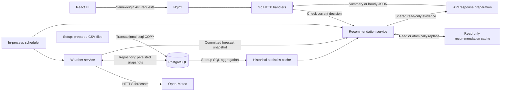

# Architecture, database design and scalability

Current implementation details are documented first. Earlier alternatives and scaling discussions are retained below and are not promises of implemented features.

## Architecture

For a step-by-step explanation of startup, job timing, scoring, cached reads and failures, see [Scheduler and recommendation architecture](docs/SCHEDULER_AND_RECOMMENDATIONS.md).

The application runs as three services: a React/TypeScript frontend served by Nginx, a Go API with an in-process scheduler, and PostgreSQL. A separate, one-shot setup container loads the prepared seed. Node.js is used to build the frontend; it is not required in the frontend runtime container.



The startup path loads zones and historical SQL statistics from PostgreSQL and restores the last persisted forecast. The scheduler then fetches weather and computes a recommendation. A successful weather refresh commits a complete snapshot before publishing it to the in-memory cache; failed requests retain the previous snapshot within its freshness limits. API requests read the current result rather than fetching weather or scanning historical data.

| Location | Responsibility |
|---|---|
| `cmd/server/` | Wire dependencies, start HTTP/scheduler, handle graceful shutdown. |
| `database/seed.psql`, `database/migrations/` | PostgreSQL setup, schema creation and transactional CSV imports with explicit reset and existing-data protection. |
| `internal/api/` | HTTP routing, status codes and read-only response preparation in `response.go`. |
| `internal/recommendation/` | Pure hourly/window scoring, decision selection, immutable-result publication, validity checks and integer JSON formatting. |
| `internal/history/`, `internal/cache/` | Reusable historical lookups and in-memory snapshots. |
| `internal/weather/`, `internal/scheduler/` | Bounded forecast fetching/retries, persistence coordination and sequential refresh jobs. |
| `internal/repository/`, `internal/repository/postgres/` | Storage contracts and PostgreSQL queries/transactions; business services do not call SQL directly. |
| `internal/domain/`, `internal/appErrors/` | Shared calendar/forecast rules and centralized errors. |
| `frontend/src/` | `components/`, `types/`, `state/`, `styles/`, `api/` and display `utils/`; `App.tsx` composes the page. `frontend/main.tsx` mounts React. |

The recommendation package separates responsibilities further: `hour.go` assesses one hour, `engine.go` aggregates/ranks zones, `service.go` joins inputs and manages result validity, `types.go` defines contracts and `json.go` rounds only outgoing trip quantities. The former deep-copy file has been removed.

Decision selection uses one pass over the completed area evidence to count assessable zones, find the highest total, and distinguish missing forecasts from insufficient history and no qualifying rain. Areas are sorted by ID first, so retaining the first equal estimate preserves the smaller-ID tie rule. Hourly scoring, input validation, result expiry and JSON rounding remain separate responsibilities.

### Recommendation ownership and responses

The scheduler constructs a complete result privately and atomically replaces the cached pointer. Once published, its nested slices, pointers and hourly values are read-only. A reader holding an older result can finish safely while a refresh publishes a new one; the old result is never edited in place.

`Manager.CurrentRecommendation` checks forecast version, planning window and expiry using the same validity helper as `NeedsRecompute`. It returns a small result value with current freshness; nested evidence is shared, not deep-copied. Go does not enforce immutability here: internal callers must honor the read-only contract.

The API builds summary responses by copying only area headers and the primary area header before omitting their hourly fields. Insights serialize the shared hourly evidence directly. Fresh responses reuse read-only warnings; stale responses allocate a separate warning list. Response preparation never truncates cached evidence or appends to cached warnings. JSON rounding remains read-only and does not affect scoring.

This reduces per-request copying within one process. It does not provide distributed scheduling or cross-instance cache consistency. Historical and forecast caches retain their existing ownership protections; this change concerns recommendation result reads only.

The current suite keeps four decision-focused tests: partial-coverage recommendation scoring, below-threshold light rain, historical SQL comparisons and provider failure/forecast expiry. Earlier cache, concurrency and response-shaping checks were removed to keep the submitted suite small; read-only ownership remains an implementation contract.

| Endpoint | Purpose |
|---|---|
| `GET /api/recommendations` | One action or explicit no-intervention/insufficient/unavailable result, with zone summaries. |
| `GET /api/areas` | Selected zone metadata. |
| `GET /api/areas/{id}/insights` | Hourly evidence for a zone. Optional `forecast_version` and `window_start` parameters bind details to the displayed decision; mismatches return 409. |
| `GET /api/health` | Ready, degraded or unavailable state. |

Usable recommendations, including insufficient evidence, return 200; unavailable recommendations return 503. The scheduler normally checks every 15 minutes and wakes at hour boundaries. Forecasts become stale after three hours, and recommendation validity ends at the next window rollover or forecast age limit of six hours, whichever comes first. The UI polls every minute, matches insight versions/windows, and hides expired actions. The Refresh button reloads API state; it does not force a new provider request.

## Data and decisions

Source references: [NYC TLC trip records and High Volume FHV data dictionary](https://www.nyc.gov/site/tlc/about/tlc-trip-record-data.page) and [Open-Meteo forecast API documentation](https://open-meteo.com/en/docs). The bundled seed is a prepared hourly aggregation, not the original trip-level download.

`data/public/areas.csv` and `historical_observations.csv` contain 20 selected zones and 697,440 matched hourly observations from NYC TLC HVFHV trips and historical weather for 2022–2025. The separate setup service runs `database/seed.psql` with PostgreSQL's client image and read-only data mounts. Two `\copy` statements import the prepared CSV files, with header/column matching, in the same transaction as schema creation or an explicit reset. Setup serializes through a transaction advisory lock, rejects existing data by default, and restricts execution to the dedicated database and public schema. Explicit reset recreates only the three assignment tables and refuses other connected clients. Import failures roll back both data and schema changes. The API image does not contain seed files or a Go seed command. Downloading, aggregation and cleanup remain offline; optional measurements use an explicit CSV null marker while zero values stay zero.

PostgreSQL stores areas, historical observations and hourly forecasts. The repository performs meaningful SQL aggregation and comparison: below-threshold/rainy averages, counts, rainy-hour sample standard deviation, and absolute/percentage differences grouped by zone, season, weekday and New York hour. Snow is excluded. Unknown statistics remain null. Go loads the reusable historical statistics at startup.

For each qualifying rainy forecast hour, additional trips are `(rainy average - below-threshold average) × precipitation probability`. Historical and forecast hours use the same numeric boundary: `0 <= rain_mm < threshold` is the comparison baseline, including dry conditions and light rain; `rain_mm >= threshold` is rainy. Below-threshold hours contribute zero modeled extra trips and require only baseline evidence. Qualifying rainy hours require both classes. The default five observations per relevant class is a coverage heuristic, not a significance test. Snow, missing forecasts and insufficient history still prevent assessment. The UI retains "Typical dry-weather trips" for readability, with a tooltip explaining that below-threshold light rain is included. JSON names such as `dry_mean` are retained for compatibility.

Go sums signed changes over the next two complete hours. Each ranked zone must be assessable for every planning-window hour. The largest qualifying total among assessed zones can be recommended even when other zones lack evidence; ties use zone ID. Coverage and warnings explicitly qualify the comparison, because excluded zones may have higher impact. No assessed zones yields insufficient evidence, or unavailable when forecast evidence is missing. Partial coverage without a qualifying action does not imply normal operations across all monitored zones. The default intervention threshold is 100 additional trips over two hours. Sample, rainfall and intervention thresholds are configurable. The UI displays backend decisions and explanations without recalculating eligibility or ranking.

Weather refreshes every three hours with three attempts, exponential backoff and jitter. Forecasts persist in PostgreSQL. Recommendations refresh hourly and after successful weather refreshes. The UI distinguishes normal, intervention, insufficient evidence, stale weather and unavailable results. Selecting another zone changes supporting evidence, not the primary decision.

## Database design and important SQL

The schema has three tables. The [up migration](database/migrations/000001_init.up.sql) creates them; the [down migration](database/migrations/000001_init.down.sql) drops them in reverse dependency order.

| Table | Stored data and keys | Design reason |
|---|---|---|
| `community_areas` | Zone ID primary key, name and representative latitude/longitude. | One shared operational scope for historical matching and live forecasts; the name is retained although the current dataset uses NYC taxi zones. |
| `historical_observations` | Primary key `(area_id, hour_start)`; foreign key to zones; trip count, historical weather and precomputed local calendar fields. | Mobility and weather are already joined offline, so runtime aggregation needs no historical join or source downloads. Optional weather measurements are nullable. |
| `weather_forecasts` | Primary key `(area_id, hour_start)`; foreign key to zones; forecast version, fetched time, rain, snow and precipitation probability. | Persists the latest complete forecast for restart recovery. Replacement is transactional; this is not a forecast-version archive. |

Primary keys prevent duplicate zone/hour records and foreign keys enforce zone references. Required database columns are `NOT NULL`. Calendar fields use New York local time while hourly timestamps are stored as `TIMESTAMPTZ`. A `(hour_start, area_id)` forecast index supports time-based access. No extra historical secondary index is added: the startup query aggregates the complete historical dataset, so an index benefit should be measured before adding one.

The main analytical query is [historical.sql](internal/repository/postgres/historical.sql):

```sql
WITH historical_stats AS (
    SELECT area_id, season, day_of_week, hour_of_day,
           AVG(trip_count) FILTER (WHERE rain_mm >= 0 AND rain_mm < $1) AS dry_avg,
           COUNT(*) FILTER (WHERE rain_mm >= 0 AND rain_mm < $1) AS dry_n,
           AVG(trip_count) FILTER (WHERE rain_mm >= $1) AS rain_avg,
           COUNT(*) FILTER (WHERE rain_mm >= $1) AS rain_n,
           STDDEV_SAMP(trip_count) FILTER (WHERE rain_mm >= $1) AS rain_stddev
    FROM historical_observations
    WHERE snowfall_cm = 0
    GROUP BY area_id, season, day_of_week, hour_of_day
)
SELECT area_id, season, day_of_week, hour_of_day,
       dry_avg, dry_n, rain_avg, rain_n, rain_stddev,
       rain_avg - dry_avg AS absolute_uplift,
       100.0 * (rain_avg - dry_avg) / NULLIF(dry_avg, 0) AS percentage_uplift
FROM historical_stats;
```

`$1` is the configured qualifying-rain threshold, default 0.5 mm/hour. This answers: **for the same zone and comparable seasonal weekday/hour, how do completed trips differ between dry and rainy conditions?** SQL performs the meaningful aggregation and comparison required by the assessment. `FILTER` keeps the two populations separate, the CTE reuses their averages, and `NULLIF` avoids division by zero. A missing mean or single-observation standard deviation remains null. Sample standard deviation measures rainy-hour dispersion, not confidence or causality.

Go consumes these SQL results and applies minimum samples, forecast probability, window summation, eligibility and ranking. For example, below-threshold mean 1,200 and rainy mean 1,700 produce SQL uplift of 500; a 90% probability gives 450 modeled additional trips in Go. This is an illustrative calculation, not a live observation.

Forecast storage uses one committed read of the current snapshot and a transaction to replace all forecast rows; readers therefore do not receive a partially replaced snapshot. [forecast.go](internal/repository/postgres/forecast.go) contains these queries. Historical SQL runs at startup and its results are cached; historical-data/config changes require a restart to rebuild that cache.

## Recommendation design history: alternatives and final decision
All counts below are approximate potential observations per area/hour before weather filtering, assuming four complete years. Selected dataset is NYC HVFHV 2022–2025, with missingness and changing travel patterns.

| Strategy | Potential samples | Pros | Cons / decision |
|---|---:|---|---|
| Exact month/day | 4 | Calendar-specific | Different weekdays, tiny rain sample; rejected |
| All-year same day/hour | 208 | Simple, more evidence | Mixes seasonal patterns; baseline for optional evaluation |
| Same month/day-of-week/hour | 17 | More seasonal relevance | Sparse rain, artificial month boundaries; rejected |
| Fixed season/day/hour | 52 | Simple SQL, reusable cache, explainable | Abrupt boundaries, sparse rain possible; selected |
| Rolling ±45 days | 52 | Smoothly moving calendar range | Date arithmetic, leap years, cache rebuild; no proven gain |
| Adaptive ±45/60/90 | 52/69/103 | More coverage when sparse | Extra rain samples may be only 3–4, broader seasons and inconsistent evidence; rejected |
| Distance-weighted calendar average | Varies | Smooth weights | Calibration, effective sample size; future |
| Regression / boosted trees / time series | Varies | Multiple factors, nonlinearities | Training, validation, serving, explainability; future |

Final: winter Dec–Feb, spring Mar–May, summer Jun–Aug, autumn Sep–Nov. All seven ISO days independently, same area and hour. Compare rainy/dry means and counts from the same group. Five samples per category is a heuristic, not statistical significance. Adding three observations to three can reduce sampling variance if representative, but cannot guarantee better accuracy; broader windows may increase bias. Fixed season is selected for clarity and scope, not because measured superiority has been established. No automatic fallback. Report insufficient evidence, coverage and old data/holiday/pandemic/temperature confounding. The original all-zone coverage policy was replaced with the user-approved assessed-zone ranking rule described above; per-zone sample requirements and historical grouping remain unchanged.

## Duration, granularity and cadence
Independent dimensions: mobility resolution 1h, weather 1h, planning horizon 2h, recommendation refresh 1h, weather fetch 3h, scheduler check 15m. Use time.Duration for scheduling and whole-hour horizons, fixed hourly hour_start and hour_of_day (0–23). Source metadata must declare hourly resolution. 4/6/12/24h use same engine, UTC iteration, local date lookup; N*H evaluations (40/80/120/240/480 at 20 zones). Cross-midnight uses each hour’s season/day/hour key; forecast coverage >= horizon+staleness+alignment. Longer horizon threshold scales 50 trips/hour, but can dilute short spikes; future peak-hour gate. Multiple simultaneous horizons need API parameter, cache key/window/version and scheduling changes; prefix sums useful for frequent windows, preserve missing-evidence counts.

| Mobility resolution | Dense rows, 20 areas x 1461 days | Evaluations for 2h |
|---|---:|---:|
| 60m | 701,280 | 40 |
| 15m | 2,805,120 | 160 |
| 5m | 8,415,360 | 480 |
| 1m | 42,076,800 | 2,400 |

Theoretical, not measured. NYC pickup timestamps may support finer aggregation, but selected weather is hourly. Hourly total cannot be divided into quarters reliably (100/200/500/400 vs assumed 300 each). Future 15m ingestion reaggregate source, change SQL alignment to containing hourly weather interval, avoid summing repeated weather, rebuild stats; no exact subhour rain claim. Minute data requires new actual event source and suitable weather resolution. At scale use COPY, partitioning, retention and incremental 1m -> 5m/15m/1h rollups preserving sums/counts and classification; choose resolution compatible with requested window. Fetching every minute does not improve model resolution and increases quotas/writes. Current implementation has no configurable data resolution and rejects non-whole-hour horizons. No raw or 15-minute artifacts are generated; retain source references and reproducible queries. The selected historical and forecast weather feeds are hourly, so finer mobility alone cannot establish subhour rain timing.

## Scoring alternatives and final policy
E=(R-D)*p for qualifying rain; p is any-precipitation probability proxy, not calibrated rain probability. Below-threshold E=0 with baseline evidence; snow remains unsupported. Sum signed effects, require complete area window, eligibility >=50 trips/hour times duration. Rank absolute additional completed trips, tie by area ID. Example rainy D1200,R1700,p=.9 ->450; next dry D1400 ->0; baseline2600, expected3050. Hypothetical only.

| Ranking | Pros | Cons / decision |
|---|---|---|
| Absolute extra trips | Direct operational scale, explainable | Favors busy areas; selected |
| Relative uplift | Highlights proportional changes | Tiny baselines can dominate; evidence only |
| Rain/dry weights | Flexible business priorities | Extra policy knobs, dry activity may distract; deferred |
| Temporal decay | Prioritizes nearer hours | Calibration, can reverse rank; deferred |
| Peak-hour risk | Captures spikes | Extra rule, longer windows can dilute spikes; future |
| Supply-gap/cost optimization | Direct operational objective | No live supply, requests or cost data; future |

Earlier weighted formula was sum decay^elapsedHours*(rainWeight*E+dryWeight*(1-p)*D). A with extra450/0 vs B100/400: unweighted B wins500 vs450, decay .8 A wins450 vs420. This illustrates why policy weights are not predictions and why we defer them. No weights in current config/API.

## Validation and industry context
Optional small held-out comparison: train on 2022–2024, evaluate 2025; compare fixed season vs all-year same-day/hour, report MAE on common cases, coverage separately, rainy-hour errors. Observed weather tests conditional estimates only; archived forecasts needed for end-to-end evaluation. No intervention outcome or causal validation possible. Do not claim results before running. Mature marketplace systems can combine live supply/demand, events, weather and learned forecasting with separate decision engines and outcome feedback; our dataset lacks those signals. Published reading leads (not reverified in this revision): Uber engineering forecasting introduction and airport driver availability, DoorDash engineering ensemble forecasting and causal forecasting. These motivate future work, not requirements or claims about current internal systems.

## Data preparation and weather geography
NYC HVFHV monthly Parquet, projected Go Parquet aggregation, official taxi zone lookup, editable JSON placeholders and manually supplied representative coordinates. Top 20 valid NYC zones by historical pickup volume; configurable all-zone expansion. Same hourly area contract, three artifacts and three runtime tables. Historical weather per zone/year with weighted quota pacing and checkpoints; live coordinate batches of 20. No spatial runtime or automatic grid deduplication. See plan.md for exact preparation contract.

## Reliability and scaling stages

Live weather implementation: seeded areas are fetched in configurable batches with bounded workers. Rain, snow and precipitation probability are all shifted from the preceding-hour label to the same hour-start interval. Explicit UTC `start_hour`/`end_hour` bounds include the extra boundary sample; Open-Meteo rejects combining these bounds with `forecast_hours`, so the client does not send both. Response counts, optional location IDs/order, grid-coordinate proximity, units, parallel arrays and complete hourly coverage validate before publication. Grid coordinates are allowed to differ from requested points; the documented response order associates them with the requested zones.

Forecast replacement uses one PostgreSQL transaction for validation, delete and COPY. Readers use one SELECT, and the in-memory snapshot is published only after commit. Unknown commit outcomes trigger a bounded reload and never a blind write retry; failed reconciliation suppresses the cache. Runtime and offline preparation share the persisted weighted quota ledger. The current single weather worker runs at startup and every configured weather interval; the combined weather/recommendation scheduler remains the later scheduler task. Historical-only or forecast-only startup never claims recommendation readiness.
Single instance: sequential scheduler, immutable versioned snapshots, persistent forecast, in-memory cache, bounded retry/timeouts, stale/expired distinction, graceful shutdown. No distributed lock needed. Multiple replicas: shared stats/results cache (Redis adapter), single elected scheduler or dedicated worker, fencing/version checks, transactional publication; Redis alone does not coordinate jobs. High event throughput: queue/stream only when continuous ingestion exists, idempotent consumers, event-time windows and backpressure. Large historical store: partition, incremental summaries, retention and query profiling. High frontend traffic: cached API, CDN static assets, conditional requests; no websocket needed for hourly changes. At 20 areas every 3h ~160 area forecast evaluations/day vs every minute ~28,800, before batching/quotas; actual API units differ. Monitor duration, failures, coverage, freshness, cache hit and DB plan; scale based on measured bottleneck.

## Repository portability and storage migration
The Go service layer depends on domain-oriented AreaRepository, HistoricalRepository and ForecastRepository contracts. PostgreSQL adapter owns SQL, pgx, null mapping and atomic forecast replacement; the composition root injects it. Scoring remains pure. Use real PostgreSQL integration tests for SQL and fakes for service failure scenarios. Avoid generic CRUD, ORM and leaky query abstractions.

MySQL can implement equivalent aggregation using CASE expressions, appropriate indexes and transactions. DynamoDB needs access-pattern-driven keys and likely offline/precomputed seasonal summaries; do not scan raw history per recommendation. For atomic forecast publication, write immutable versioned items, verify completeness, then conditionally update a current-version pointer; readers use that version. These are future designs, not implemented. Migrations, seeding, connection wiring, operational guarantees and adapter tests must change; stable domain contracts protect scoring, scheduler and API from storage-specific changes. A repository does not make database migration free.

## All-zone extension
At illustrative 263 zones: 9,221,832 hourly observations before exclusions, 176,736 historical keys, 526 evaluations per two-hour window, 14 live HTTP batches per refresh and ~2,104 daily location units. Historical quota ~27,446 before padding/rounding/retries; spread over days or appropriate paid plan. No schema or scorer changes for independent zone weather. Future shared weather locations could reduce quotas but need validated grid mapping and potentially normalized five-table schema; deferred to preserve assignment scope. Revalidate thresholds, coverage, startup time, scheduler deadlines and frontend usability.

## Dataset decision and measured experiments
Chicago TNP was the original source. Basic date-filtered retrieval (5 rows) succeeded in 1.294196s; single-day COUNT and seven-day aggregation timed out at 60s with no response. Five-column CSV returned 23,259 parsed rows in an incomplete 60s response (735,914 transferred bytes, 2.299 MiB local); two-column CSV requested 10,000 rows in 13.675634s (HTTP 200, 14,405 transferred bytes; actual row count not verified). The attempted bulk export endpoint returned HTTP 410 in 1.562915s; other exports were not ruled out. NYC January 2022 Yellow Taxi Parquet downloaded 38,139,949 bytes in 3.466139s; HVFHV downloaded 374,619,188 bytes in 31.026937s, both HTTP 200. These are user-measured download experiments, not controlled database comparisons. HVFHV is selected for marketplace relevance; Yellow Taxi is smaller but less directly representative. Go Parquet aggregation on a full official month, official zone metadata and live weather coverage remain unverified. Four years and 20 zones are initial scope, not proven optimal. More trips per hour do not increase the number of independent rainy hours.
