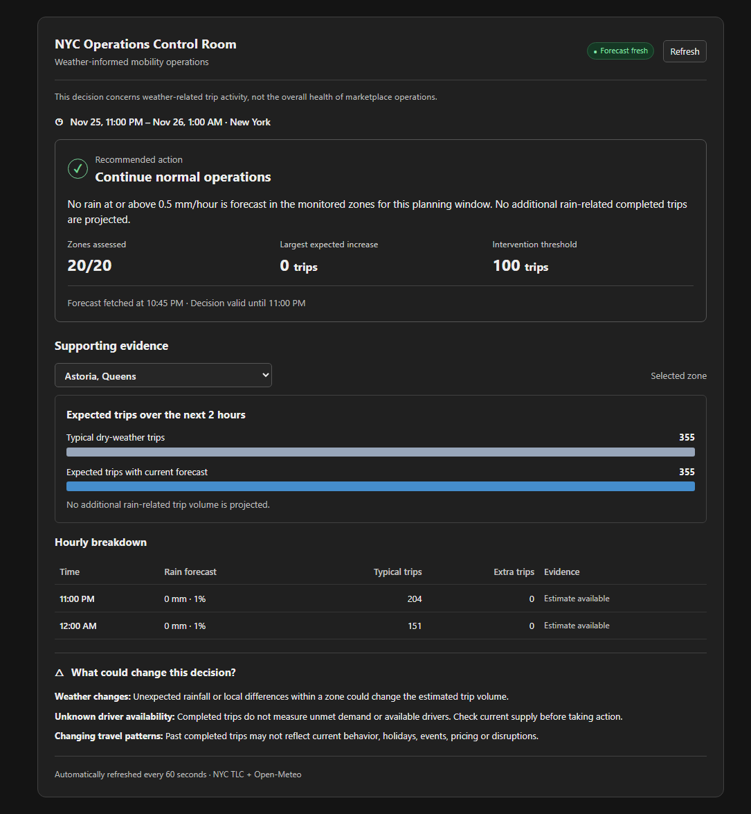

# NYC Operations Control Room

A weather-informed mobility dashboard for 20 selected NYC taxi zones. It recommends reviewing driver availability in the zone with the largest qualifying increase in completed trips, or explains why no intervention can be recommended. Completed trips measure activity, not unmet demand or driver supply.

## Run

From the repository root with Docker Compose:

```sh
docker compose run --rm --build setup
docker compose up --build api frontend
```

Open http://localhost:3000. The API is at http://localhost:8080/api/recommendations. **Setup resets the dedicated assignment database. Stop the application first and never use setup against a database whose contents you need to preserve.** Normal startup does not reset data. The Docker setup/build/start workflow was verified on November 26, 2026.

After startup, run `powershell -File scripts/verify-reviewer-setup.ps1` to check Docker, Compose configuration, the served frontend and the API through Nginx. The check never resets data. It reports a weather-related HTTP 503 for review rather than treating it as a normal recommendation. The backend image includes only the prepared seed JSON, not original download artifacts.

For local development, use Go 1.25+, PostgreSQL and Node.js 22. Configure environment variables using [.env.example](.env.example). Go reads environment variables directly; Compose loads an optional `.env` file.

```sh
go run ./cmd/seed -data data/public -validate-only
go run ./cmd/seed -data data/public
go run ./cmd/server
```

Seeding requires an empty database; the explicit `-reset` option recreates the dedicated assignment database. In another terminal:

```sh
cd frontend
npm ci
npm run dev
```

The frontend proxies requests to port 8080. It refreshes every 60 seconds and suppresses expired recommendations and results from failed refreshes.

## Data and decisions

`data/public/seed.json` contains 20 selected zones and 697,440 matched hourly observations from NYC TLC HVFHV trips and historical weather for 2022–2025. Initialization validates JSON fields and inserts prepared observations. Downloading and aggregation tools remain separate in the ignored `data-preparation/` folder, excluded from the Docker build and unnecessary at startup.

PostgreSQL stores areas, historical observations and hourly forecasts. The repository performs meaningful SQL aggregation and comparison: dry/rainy averages, counts, rainy-hour sample standard deviation, and absolute/percentage differences grouped by zone, season, weekday and New York hour. Snow is excluded. Unknown statistics remain null. Go loads the reusable historical statistics at startup.

For each forecast hour, additional trips are `(rainy average - dry average) × precipitation probability`. Dry hours contribute zero extra trips and require only dry evidence. Rainy hours require both classes. The default five observations per relevant class is a coverage heuristic, not a significance test. Snow, trace rain, missing forecasts and insufficient history prevent assessment.

Go sums signed changes over the next two complete hours. All monitored zones must be assessable before selecting the largest qualifying total; ties use zone ID. The default intervention threshold is 100 additional trips over two hours. Sample, rainfall and intervention thresholds are configurable. The UI displays backend explanations and effective settings without recalculating eligibility or ranking.

Weather refreshes every three hours with three attempts, exponential backoff and jitter. Forecasts persist in PostgreSQL. Recommendations refresh hourly and after successful weather refreshes. The UI distinguishes normal, intervention, insufficient evidence, stale weather and unavailable results. Selecting another zone changes supporting evidence, not the primary decision.

## Screenshots

Normal operations captured against the real API and selected 20-zone dataset:



Intervention example: **illustrative development scenario with fictional weather and historical inputs**, using two zones. The 450 additional trips are not a live forecast or observed result. The actual scoring function produces this example.


Generate five development scenarios with `go run ./tests/ui-fixtures` from the repository root. Outputs go only to ignored `.local/ui-fixtures/`. Manual browser checks substitute responses within the browser and display an illustrative label. There is no production demo toggle, fixture endpoint or database mutation.

## Validation

```sh
go test ./...
go vet ./...
go build ./...
npm run build --prefix frontend
```

Three focused backend tests cover recommendation behavior/messages, SQL historical evidence and retaining the previous forecast when the external API fails. Set `TEST_DATABASE_URL` to a dedicated PostgreSQL test database to include SQL verification; that case creates/removes its own temporary schema and skips without the variable.

Manual browser checks cover all five states on desktop and mobile, selection, selection reset on a new decision, expiry suppression and browser exceptions. Docker verification seeded 20 zones and 697,440 observations, built and started all services, and confirmed frontend HTTP 200, proxied API access, ready health and a fresh recommendation covering 20/20 zones.

## Limitations and implementation

Historical associations do not establish causation. Old observations may not reflect current travel patterns, holidays, pricing or disruptions. Precipitation probability is a proxy for qualifying rain, and weather varies within zones. Counts and standard deviation describe historical evidence, not calibrated confidence. Only selected zones are monitored; the application cannot establish a driver shortage. The dashboard keeps controller-facing warnings concise and omits sample counts, historical-statistics tables and calculation details.

Backend JSON responses round trip quantities to whole integers; missing values remain null. Scoring, ranking and threshold comparisons retain full precision before serialization. Percentages and weather measurements retain decimals. Hourly values and window totals are rounded independently, so displayed hourly figures can differ slightly from a displayed total.

The Go API separates handlers, recommendation logic, weather fetching and PostgreSQL repositories. Initialization lives in `internal/seeding`; shared error handling lives in `internal/apperrors/errors.go`. React/TypeScript uses a small stylesheet without a component or chart library.

Codex assisted with implementation, refactoring, SQL, UI and validation. User decisions established the selected zones, editable coordinates, separate preparation tooling and simpler retry/design requirements. Complex quota/worker machinery was simplified, and the earlier report-style interface became a decision-first layout. Validation used focused Go tests, real PostgreSQL, frontend builds and browser checks; it does not imply independent human review or deployment verification.
