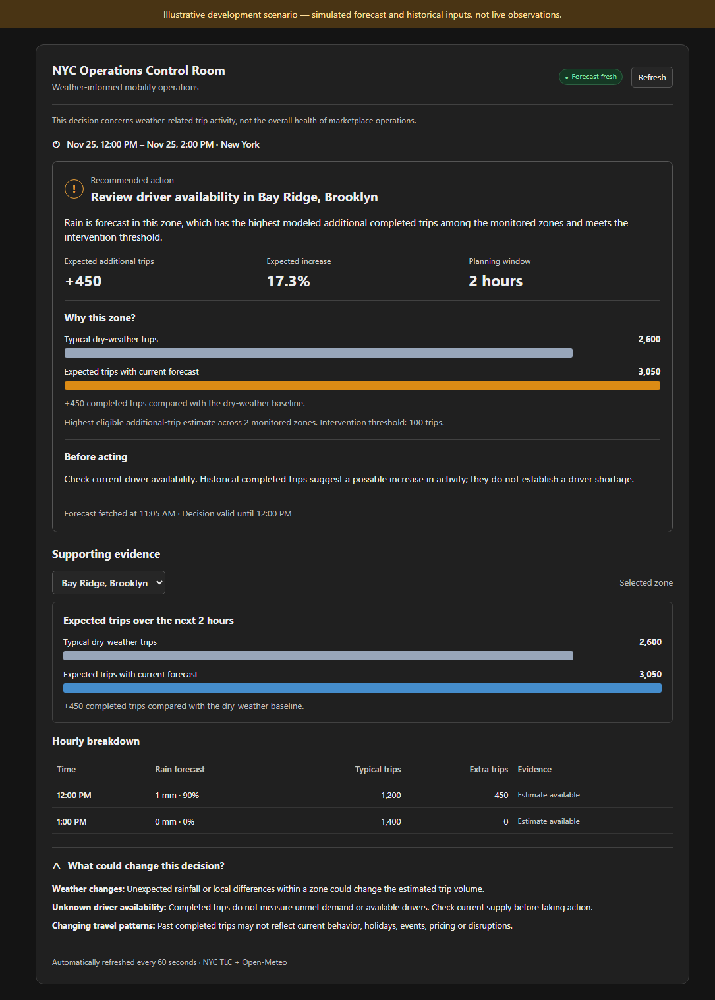

# NYC Operations Control Room

## Project overview

A marketplace operator needs to know where to check driver availability when rain is forecast. This dashboard combines [NYC TLC trip history](data/README.md) with live Open-Meteo forecasts for 20 selected taxi zones. It shows one primary recommendation or explains why an action cannot be recommended. Selecting another zone changes the supporting evidence.

## Product demonstration



The labeled fictional demo recommends **checking driver availability in Astoria**. It estimates **450 additional completed trips** against a **100-trip threshold**. In a [dry forecast from the live API](docs/normal-operations.png), the dashboard shows no rain-related action and still presents the supporting evidence.

To run the fictional scenario, start `go run ./tools/rain-demo` at the repo root and `npm run dev:sample` from `frontend`, then open [the demo](http://localhost:3001). The demo uses the same scorer and needs Go 1.25+, Node.js 22, and frontend dependencies installed with `npm ci`.

<a name="run"></a>

## Quick start

With Docker Compose, copy [.env.example](.env.example) to `.env`. The example values work with the bundled PostgreSQL service. Then run:

```sh
docker compose run --rm setup
docker compose up -d --build api frontend
```

Open [the dashboard](http://localhost:3000) or the [recommendation API](http://localhost:8080/api/recommendations). Repeat setup preserves stored data and forecasts. Partial initialization fails with a clear error.

**An explicit reset erases all assignment data, including saved forecasts.** Stop the application and other database clients before running `docker compose run --rm -e RESET_SEED=true setup`. A failed import rolls back the reset.

<details>
<summary>Run the API from a terminal</summary>

With PostgreSQL running in Compose and the data seeded, stop the containerized API. Set `DATABASE_URL` in your terminal using the same credentials as `.env` and replace `db:5432` with `127.0.0.1:15432`. Run `go run ./cmd/server`. For the UI, run `npm ci` and `npm run dev` from `frontend`.

For standalone PostgreSQL 17+, create the `mobility_control_room` database first, then run `psql "$DATABASE_URL" -X -f database/seed.psql` from the repo root before starting Go. Use `$env:DATABASE_URL` in PowerShell.

</details>

## Recommendation logic

1. Match each forecast hour to historical observations for the same zone, weekday, and New York local hour.
2. For a usable, snow-free forecast below **0.5 mm/hour**, assume zero additional rain-related trips. At or above the threshold, require at least **five observations in each historical group**, then estimate `(rainy mean − below-threshold mean) × precipitation probability`.
3. Sum the signed estimates over the next **two complete hours** by default. Recommend the highest assessed zone that meets **50 additional trips per hour** (100 over two hours). A zone must be assessable for every hour to rank. If none qualifies, show **no intervention** when coverage is complete or **insufficient evidence** when it is partial. Without usable forecast coverage, the decision is **unavailable**.

## Assumptions and limitations

- **Historical data.** The bundled data contains 697,440 hourly observations from 2022–2025. Comparing the same weekday and New York local hour preserves weekly travel patterns, such as Friday evenings differing from Monday evenings. Pooling seasons gives each bucket more examples than splitting by season, but can hide seasonal effects. Past patterns may differ from today’s.
- **Weather data.** One forecast coordinate represents each zone, so conditions can differ within it. Open-Meteo reports the chance of **any precipitation**, which the model uses as a proxy for qualifying rain. Snow and missing forecast evidence can leave an hour’s impact unknown.
- **Recommendation and scoring.** The rainfall cutoff, sample minimum, and intervention threshold are configurable heuristics. They define what to compare, screen out thin evidence, and flag an increase worth reviewing. They are neither confidence levels nor cutoffs calibrated against operational outcomes. Zero below the rain threshold is a modeling rule. Unknown impact stays unknown.
- **Operations.** The prototype assumes one application instance and covers only the 20 selected zones. It plans from the next full hour, leaving the rest of the current hour outside the estimate. By default, a forecast is marked stale at three hours and can be reused up to six hours if it still covers the requested window. The decision expires when its planning window starts or the forecast reaches its age limit, whichever comes first.
- **Known limitations.** **Estimated additional completed trips** are a modeled change from a historical baseline. The app has no real-time view of actual trip demand, riders waiting or unable to get a ride, or available drivers. It cannot establish unmet demand or a driver shortage, or say how many drivers to move. Holidays, events, closures, pricing, and service disruptions are outside the model. The historical comparison does not establish that rain caused the difference. Predictive accuracy and intervention benefit remain unmeasured.

See [assumptions and trade-offs](TRADEOFFS.md) for the reasoning behind these choices.

## Architecture

A one-shot setup container loads the CSVs. The Go API loads historical aggregates at startup, and one scheduler fetches and persists forecasts and publishes a cached recommendation. React and TypeScript, served by Nginx, display the primary decision and request zone evidence tied to the same forecast version and window. [Architecture overview](DESIGN_AND_SCALABILITY.md#architecture) · [Scheduler and failure behavior](docs/SCHEDULER_AND_RECOMMENDATIONS.md)

## Database design and SQL

[Three PostgreSQL tables](database/migrations/000001_init.up.sql) store zone metadata, historical observations, and the latest complete forecast. The [historical query](internal/repository/postgres/historical.sql) uses filtered averages and counts to compare rainy and below-threshold trips within each zone, weekday, and New York hour. It excludes observations with snowfall. Go applies the forecast probability, window and eligibility rules to those aggregates.

<a name="validation"></a>

## Testing

```sh
go test ./...
go test -race ./...
go vet ./...
go build ./cmd/server ./tools/rain-demo
npm run lint --prefix frontend
npm run build --prefix frontend
```

The three focused tests check [partial-coverage decisions](tests/recommendation_test.go), [PostgreSQL rain classification and forecast precision](tests/forecast_precision_test.go), and [provider failure](tests/weather_test.go). Set `TEST_DATABASE_URL` to a dedicated PostgreSQL database to run the integration test in a temporary schema. The race detector requires a supported C toolchain.

Docker and browser checks covered setup and rollback, dry and rainy decisions, insufficient evidence, recovery during an outage, graceful shutdown, and zone selection. These checks verify behavior with controlled fixtures.

## Engineering trade-offs

Aggregating history once keeps the request path small, at the cost of restarting the API when history changes. A single scheduler and a transaction for forecast replacement keep publication simple and allow recovery after a restart. [An integration test caught forecast rounding across restart](DESIGN_AND_SCALABILITY.md#forecast-precision-across-restart). Switching the scoring weather fields to `DOUBLE PRECISION` preserves the original values.

## AI collaboration

I made the product and engineering decisions, prepared the dataset, and did the initial implementation, review and testing. I used ChatGPT to discuss design options and Codex to verify behavior, suggest improvements, and implement selected changes at my request. I implemented many suggestions myself and reviewed the changes Codex made before deciding what to keep. [AI-use disclosure](MY_REASONING.md#ai-use-disclosure)
