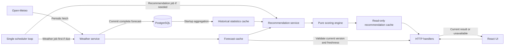

# Scheduler and recommendation architecture

The application separates background refresh work from HTTP request handling. A single scheduler refreshes weather and computes recommendations. Requests read a completed recommendation and verify that it still matches the current forecast and planning window.

This keeps provider calls and historical aggregation outside the request path. The design targets one application instance and prioritizes explicit data validity, explainable scoring and a small operational footprint.

## Components and data flow



| Component | Responsibility | Implementation |
|---|---|---|
| Server | Initialize dependencies, start HTTP and the scheduler, coordinate shutdown | [cmd/server/main.go](../cmd/server/main.go) |
| Scheduler | Decide when jobs run, apply job timeouts and record outcomes | [scheduler.go](../internal/scheduler/scheduler.go) |
| Weather service | Fetch, validate, persist and publish forecasts; report their current usability | [weather/service.go](../internal/weather/service.go) |
| Historical service | Look up aggregated evidence by zone, season, weekday and local hour | [history/service.go](../internal/history/service.go) |
| Recommendation service | Join evidence, invoke scoring, publish results and validate cached reads | [recommendation/service.go](../internal/recommendation/service.go) |
| Scoring engine | Estimate trips and select an action among assessable zones without storage or network calls | [engine.go](../internal/recommendation/engine.go) and [hour.go](../internal/recommendation/hour.go) |
| API | Prepare summaries, return hourly evidence and expose health status | [api.go](../internal/api/api.go) |

## Startup and ownership

Startup opens PostgreSQL, loads zones and historical aggregates, and restores the last saved forecast. Historical aggregation runs once per API startup; subsequent recommendations use the in-memory statistics. Historical-data or grouping-configuration changes require a restart to refresh that cache.

The server then creates an empty recommendation cache, starts one scheduler goroutine, and starts the HTTP server. The first scheduler check attempts a weather refresh followed by recommendation computation. HTTP requests arriving before a usable result is published receive an unavailable response.

| Stored data | Owner and lifecycle |
|---|---|
| Job state | Scheduler loop only. Tracks weather and recommendation attempts, successes and errors; resets on restart. |
| Historical statistics | Loaded at startup and reused for scoring. |
| Forecast snapshot | Weather service publishes a complete version with fetch time and hourly weather for each zone. PostgreSQL supports recovery after restart. |
| Recommendation result | Recommendation service builds and publishes the result in memory. HTTP readers must treat its nested evidence as read-only. |

Scheduler state is not the forecast or recommendation cache. `LastAttempt` records a job's start time after the job returns, including failed jobs. `LastSuccess` changes only on success. `LastError` holds an empty string or `refresh_failed`; detailed causes are logged. Empty timestamps identify jobs that have not completed an attempt since startup.

## Scheduling and refresh policy

`Run()` calls its private `tick()` synchronously, calculates a wait, and then waits for the timer or cancellation. Each tick runs weather first if due, followed by recommendation computation if required. Jobs execute sequentially.

Weather refresh becomes due on the first tick or when the configured interval has elapsed since the last attempt. Recommendation computation runs after a successful weather refresh, on its first attempt, at its regular refresh interval, or when `NeedsRecompute()` detects an invalid cached result.

| Setting | Default | Purpose |
|---|---:|---|
| Scheduler check | 15 minutes | Check for work; wake sooner at an hour boundary. |
| Weather refresh | 3 hours | Start another weather job when due; also marks saved weather stale. |
| Recommendation refresh | 1 hour | Regular computation interval; changed weather or windows can trigger computation sooner. |
| Planning window | 2 hours | Assess the next two complete future hours. |
| Forecast horizon | 30 hours | Request hourly weather for each selected zone. |
| Weather maximum age | 6 hours | Limit the age of weather supporting a recommendation. |
| UI polling | 60 seconds | Read the API without triggering background jobs. |

The client retries temporary provider failures up to three times within a fetch, with a default 10-second attempt timeout and 20-second total request budget. After that fetch fails, the scheduler normally waits until the three-hour interval from the last weather attempt before fetching again. The 15-minute check interval is not a provider retry interval. Scheduler job timeouts provide an additional bound.

When weather is unusable, the recommendation service publishes an unavailable result. `NeedsRecompute()` does not repeatedly request the same unavailable result solely because weather remains unusable; the regular refresh interval can still trigger computation.

## Planning windows and expiry

Planning starts at the next full UTC hour, even when the current time is exactly on the hour. The UI displays the window in New York time. Current-hour partial estimates are outside the implemented model because historical evidence consists of whole hourly observations.

For example, using UTC times:

| Time | Planning window and scheduler behavior |
|---|---|
| 10:53 | Compute for 11:00-13:00. The result normally expires at 11:00. |
| After the tick | Wait about seven minutes to the hour boundary rather than the full 15-minute interval. |
| 11:00 | The window changes to 12:00-14:00; compute a replacement. |
| 11:15 | Check again; unchanged, valid inputs do not require recomputation. |

Waiting 15 minutes at 10:53 would leave the expired result unavailable from 11:00 until computation starts at 11:08. The hour-boundary wake-up avoids that scheduling delay. Computation and any preceding weather job still take time, so replacement is not guaranteed to be instantaneous.

Result expiry is the earlier of the next hour boundary or the forecast's maximum-age deadline. The API enforces expiry on every read, independently of scheduler timing.

## Recommendation computation

Start at `Manager.ComputeAndPublish()` in [recommendation/service.go](../internal/recommendation/service.go). `Manager` is a Go struct with methods, serving the role of a coordinator class. It owns the historical and weather dependencies, scoring options and result cache. The workflow is written as four sequential steps:

| Step | Call | Responsibility |
|---|---|---|
| 1 | `weather.CurrentForecast(now)` | Read and validate the cached forecast. |
| 2 | `joinForecastAndHistory()` | Match forecast hours with cached historical trip statistics. |
| 3 | `EvaluatePlanningWindow()` | Calculate hourly estimates, sum zones and select the decision. |
| 4 | `publishRecommendation()` | Attach forecast metadata, limit expiry and publish the completed result. |

An error stops the workflow before the next step. An unusable forecast publishes an unavailable result; cancellation or other computation errors retain the existing cache. Cached reads still enforce validity. Live weather fetching belongs to the scheduler's preceding weather job, not to this computation method.

```text
Scheduler.tick()
  -> runRecommendationJob()
  -> Manager.ComputeAndPublish()
     -> CurrentForecast(now)
     -> joinForecastAndHistory()
     -> EvaluatePlanningWindow()
        -> estimateAreaWindow()
           -> estimateHourTrips()
        -> selectScopeDecision()
     -> publishRecommendation()
        -> attach forecast version and expiry
        -> atomically publish the completed result
```

`CurrentForecast()` reads cached weather and checks its age and window coverage; it does not call the provider. A forecast snapshot contains its version, fetch time and hourly rain, snowfall and precipitation probability, normally 600 records for 20 zones over 30 hours.

`joinForecastAndHistory()` matches each zone/hour with historical statistics for the same season, weekday and New York local hour. The engine then applies the following rules:

- Rainfall below the configured threshold, including light rain, uses the below-threshold historical comparison and contributes zero modeled additional trips.
- Rainfall at or above the threshold uses `(rainy mean - below-threshold mean) * precipitation probability / 100`.
- A below-threshold hour requires enough baseline observations; a qualifying rainy hour requires both classes. Defaults are five observations per relevant class and 0.5 mm/hour.
- Snow, missing forecasts and insufficient historical evidence prevent assessment of the affected hour. A zone receives totals only if every planning-window hour is assessable.
- Signed changes are summed across the window. The highest assessed total qualifies when it reaches 50 additional trips per hour of window duration, or 100 over the default two hours. Ties use the smaller zone ID.

Illustrative inputs of 1,200 typical trips, 1,700 rainy trips and 90% precipitation probability produce 450 additional trips for a qualifying rainy hour. A following below-threshold hour adds zero. This is a modeled association in completed trip activity, not evidence of a driver shortage or a driver count to move.

Incomplete zones do not veto an eligible zone. Recommendations identify the highest estimate among assessed zones and report assessed/total coverage, with a warning that excluded zones may have higher impact. With partial coverage, no qualifying assessed zone does not imply normal operations across the full monitored scope.

## Request handling and consistency

```text
GET /api/recommendations
  -> handleRecommendations()
  -> Manager.CurrentRecommendation(now)
     -> check weather usability
     -> load the cached result
     -> match forecast version and planning window
     -> check expiry
  -> prepare a summary without modifying cached evidence
  -> return JSON
```

A cached pointer can exist after its result becomes invalid. Every read therefore checks validity rather than assuming that a previously computed result is current. The UI also hides expired results and suppresses results from failed refreshes. Its Refresh button reads API state; it does not trigger scoring or a weather fetch.

Summary responses omit hourly evidence by copying area headers. Insight responses read the same cached evidence. Optional forecast-version and window-start parameters bind insights to the displayed decision; a mismatch returns HTTP 409 and prompts the UI to refresh.

## Failure behavior

| Condition | Result |
|---|---|
| Provider fetch fails | Retain previous committed weather within its usability limits. |
| Weather reaches three hours old | Mark it stale; it remains usable with sufficient coverage until the recommendation's expiry deadline. |
| No usable weather, insufficient forecast coverage or an expired recommendation | Return unavailable with HTTP 503; do not return an old action. |
| No zone has enough evidence | Return insufficient evidence, or unavailable if forecast evidence is missing. |
| Some zones are assessable | Rank only complete zones, display coverage and report degraded health. |
| No assessed zone reaches the threshold | Return no intervention for the assessed scope. |

Provider snapshots are validated and committed in full before publication to memory. Allowing partial recommendation coverage does not bypass complete-snapshot weather validation. A failed or invalid fetch does not partially replace committed weather.

## Concurrency and shutdown

The server starts one scheduler loop, which owns all job state and waits for each job to finish before continuing. No scheduler-state reader exists in the HTTP layer. Scheduler ticks and state therefore require no mutex under this ownership model; `Run()` must be called once per scheduler instance.

HTTP readers do execute concurrently with background updates. Forecast caches protect ownership through copied snapshots. Recommendations are constructed privately and published through an atomic pointer replacement; published nested data remains read-only by contract. Atomic publication prevents partial results, but does not protect against a caller mutating shared evidence. The weather service retains a separate guard against overlapping refresh calls.

Shutdown cancels the scheduling loop and in-flight jobs, coordinates HTTP shutdown, and waits for the scheduler worker before closing the database pool.

## Design tradeoffs and scope

| Choice | Benefit | Limitation |
|---|---|---|
| One scheduler with sequential jobs | Simple ownership and predictable execution order | A slow weather job can delay recommendation computation. |
| Startup historical aggregation | Avoids repeated historical scans during scoring and requests | Historical changes require restart. |
| In-memory recommendation cache | Small request path and atomic publication | Results must be recomputed after restart; caches are not shared across replicas. |
| Next complete hourly intervals | Aligns scoring with available hourly observations | Provides no estimate for the remainder of the current hour. |
| Assessed-zone ranking | Retains useful actions when evidence is incomplete elsewhere | Cannot claim the winner has the highest impact among all monitored zones. |

The implementation assumes one application instance. Multiple replicas would require coordinated scheduling and a cache-consistency strategy. Thresholds and the probability-weighted historical comparison remain explicit heuristics rather than calibrated predictions or causal estimates.

## Sample scenario and validation

The separate [rain demo](../tools/rain-demo/main.go) supplies fictional inputs to the same scoring engine and API handlers. It computes on request without the scheduler, database or provider. Its API/UI ports are 8081/3001, separate from the normal 8080/3000 application. It demonstrates calculation and presentation rather than the production refresh lifecycle.

Four focused tests cover assessed-zone recommendations, light rain without intervention, historical SQL comparisons and retaining usable forecasts during a provider outage while rejecting expired weather. See [recommendation tests](../tests/recommendation_test.go), [historical SQL test](../tests/historical_test.go) and [weather failure test](../tests/weather_test.go). Broader concurrency and response-shaping checks are outside the retained test suite.
